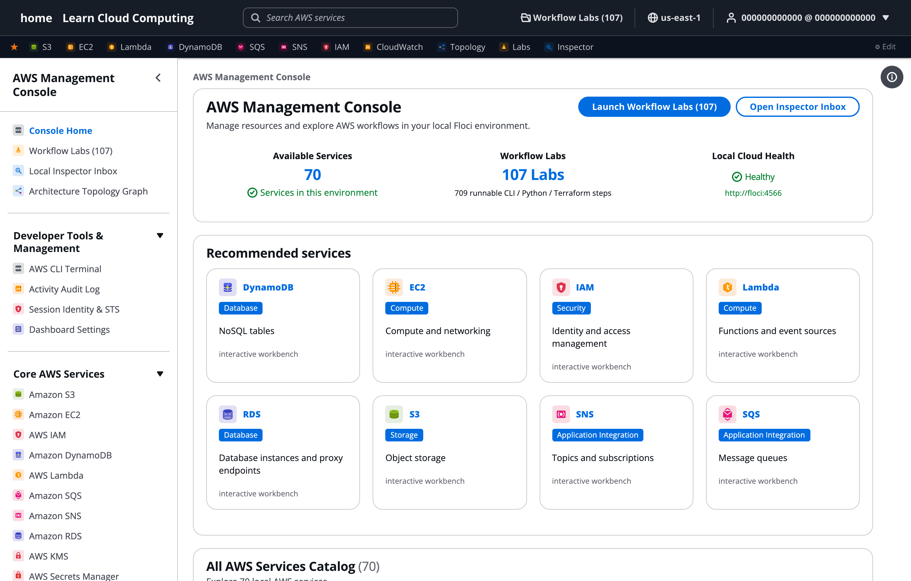

# Floci Dashboard 2.3.0

A local AWS console for [Floci](https://floci.io/), the open-source AWS emulator. Browse 70 AWS services and work through 120 hands-on labs for AWS certification exams, all on your own machine with no AWS account.



## Get started

You need [Docker](https://www.docker.com/products/docker-desktop/) (with Compose) and Git.

```bash
git clone https://github.com/cloudexplainers/flocidashboard.git
cd flocidashboard
docker compose up -d
```

Then open **[http://localhost:8001](http://localhost:8001)**. That's it: Compose starts Floci and the dashboard together.

To stop it, run `docker compose down`. To stop it and wipe everything you created, run `docker compose down -v`.

If port 8001 is already taken on your machine, copy `.env.example` to `.env`, set `DASHBOARD_PORT` to a free port, and run `docker compose up -d` again.

## Learn cloud computing

Floci Dashboard is made by **Cloud Explainers**. For videos and guides on AWS and cloud concepts:

- YouTube: [youtube.com/@cloudexplainers](https://www.youtube.com/@cloudexplainers)
- Website: [cloudexplainers.com](https://cloudexplainers.com)

## What's new since 2.3.0

- Lab code snippets fixed: every lab's AWS CLI, Python, and Terraform examples were checked against a live Floci, and the Terraform tab now shows real Terraform for around 90 resource types.

See the [changelog](./CHANGELOG.md) for every release.

## More

- [Full guide](./docs/guide.md): features, configuration, local development without Docker, labs, and testing
- [Contributing](./CONTRIBUTING.md)
- [Roadmap](./ROADMAP.md)

This is a local learning and development tool, not the AWS Management Console.
